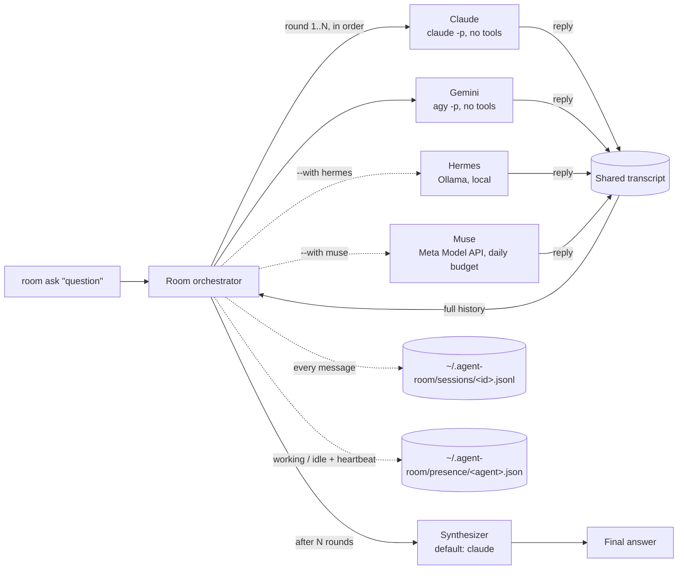

# multi-agent-memory-hub

A local "room" where several AI models work on the same question together.
By default Claude and Gemini answer in turn; Hermes (running locally through
Ollama) and Muse can be added per run. Every agent can read the shared
transcript of what the others said, and after a configurable number of rounds
one agent writes a synthesized final answer. While an agent is thinking, the
room publishes a small presence file so other local tools can tell the machine
is busy, and every message is saved to a JSON Lines session log that a future
graph-memory layer will ingest.

## Architecture



- **Agents** (`src/room/agents/`): one adapter per model behind a common
  interface: `name`, `async reply(task, transcript) -> str`,
  `async healthcheck() -> (bool, str)`. Adapters turn every failure into a
  clear error message; they never crash the room.
- **Orchestrator** (`src/room/orchestrator.py`): health-checks the agents,
  skips unreachable ones with a note, runs N rounds where each agent sees the
  full transcript, then asks the synthesizer for the final answer. If the
  synthesizer fails, it falls back to another agent that replied. Before every
  call it asks the agent for a `skip_reason()` (used by Muse's daily token
  budget) and records that as a note instead of calling.
- **Presence** (`src/room/presence.py`): atomic `working`/`idle` files with a
  30 s heartbeat; readers treat `working` older than 120 s as stale. Contract:
  [docs/PRESENCE.md](docs/PRESENCE.md).
- **Session log**: one JSONL line per message. Format:
  [docs/SESSIONS.md](docs/SESSIONS.md).

### Agents

| Name         | Default? | Backend | Auth |
|--------------|----------|---------|------|
| `claude`     | yes      | Claude Code CLI (`claude -p`) | your Claude Code login |
| `gemini`     | yes      | Antigravity CLI (`agy -p`) | your Google sign-in in `agy` |
| `hermes`     | opt-in   | Ollama, OpenAI-compatible API | none (local) |
| `muse`       | opt-in   | Meta Model API, OpenAI-compatible | `MUSE_API_KEY` |
| `gemini-api` | opt-in   | Gemini API via `google-genai` | `GEMINI_API_KEY` |

## Setup

Requirements: macOS or Linux, Python 3.11+, and whichever of these you want
to use:

- [Claude Code](https://claude.com/claude-code), logged in (`claude` on your PATH)
- The Antigravity CLI (`agy`), signed in with your Google account
- Optional: [Ollama](https://ollama.com) with the Hermes model: `ollama pull hermes3:8b`
- Optional: a Meta Model API key for Muse
- Optional: a Gemini API key, only for the `gemini-api` agent

```bash
git clone https://github.com/Bjay4910/multi-agent-memory-hub.git
cd multi-agent-memory-hub
python3 -m venv .venv
source .venv/bin/activate
pip install -e ".[dev]"
```

### Configuring keys

The default agents need **no API keys**: `claude` and `gemini` use the logins
of their CLIs. Keys for the opt-in API agents are read **only from environment
variables**. Nothing is read from or written to a config file, and `.env` files
are git-ignored:

```bash
export MUSE_API_KEY=...     # muse
export GEMINI_API_KEY=...   # gemini-api
```

Error messages pass through a redaction step, so a key value never appears in
the terminal, the session log or presence files. Both CLI agents run with
these key variables removed from their environment.

### Choosing agents

`room ask` uses the default agents (`claude,gemini`) unless told otherwise:

- `--with muse` (or `--with muse,hermes`, repeatable) adds opt-in agents to
  the list.
- `--agents hermes,claude` replaces the list for one run.
- `ROOM_DEFAULT_AGENTS=claude,gemini,hermes` changes the default list.

### Optional settings

| Variable                 | Default                      | Purpose |
|--------------------------|------------------------------|---------|
| `ROOM_DEFAULT_AGENTS`    | `claude,gemini`              | Default agent list for `room ask` |
| `AGY_BIN`                | `agy` on PATH, else `~/.local/bin/agy` | Antigravity CLI executable |
| `AGY_MODEL`              | CLI default                  | Passed as `agy --model` (list with `agy models`) |
| `AGY_TIMEOUT`            | `120`                        | Seconds before the `agy` process group is killed |
| `CLAUDE_MODEL`           | CLI default                  | Passed as `claude --model` |
| `CLAUDE_TIMEOUT`         | `180`                        | Seconds before the `claude` process group is killed |
| `HERMES_MODEL`           | `hermes3:8b`                 | Ollama model |
| `HERMES_BASE_URL`        | `http://localhost:11434/v1`  | Ollama endpoint |
| `MUSE_MODEL`             | `muse-spark-1.1`             | Muse model id |
| `MUSE_BASE_URL`          | `https://api.meta.ai/v1`     | Muse endpoint |
| `MUSE_DAILY_TOKEN_LIMIT` | `200000`                     | Max Muse tokens per UTC day (see below) |
| `GEMINI_MODEL`           | `gemini-4-hydrogen`          | Model for `gemini-api` |
| `AGENT_ROOM_HOME`        | `~/.agent-room`              | Where presence, session and usage files go |

### Muse budget guard

Muse is a paid API, so the room caps how many Muse tokens it spends per day.
After every successful Muse call, the token count reported by the API (or an
estimate of about 4 characters per token if the API reports none) is added to
`~/.agent-room/usage/muse.json`:

```json
{"agent": "muse", "days": {"2026-11-17": 1834}, "updated_at": "2026-11-17T16:49:47Z"}
```

Before each Muse call, the room checks today's total (UTC day). Once it reaches
`MUSE_DAILY_TOKEN_LIMIT`, Muse is not called again that day. The rest of the room
keeps going, and the transcript gets a note such as
`muse skipped this round: muse: daily token limit reached (200000/200000 tokens used today, UTC)`.
The check runs before each call, so the call that crosses the limit can
overshoot it by one reply. An invalid limit value (for example `abc`) disables
Muse rather than removing the cap. `room agents` shows today's usage.

## Usage

Check which agents are reachable:

```bash
room agents
```

```
OK    claude     default  Claude Code CLI 2.1.326 (login not verified)
OK    gemini     default  Antigravity CLI 1.5.10 (sign-in not verified)
OK    hermes     opt-in   model hermes3:8b at http://localhost:11434/v1
OK    muse       opt-in   model muse-spark-1.1 at https://api.meta.ai/v1, budget 696/200000 tokens today
OK    gemini-api opt-in   model gemini-4-hydrogen
```

Ask the room a question (replies print as they arrive, then the final answer):

```bash
room ask "What are the trade-offs of event sourcing?"            # claude + gemini
room ask "What are the trade-offs of event sourcing?" --with muse
room ask "In one sentence, what is a graph database?" --agents hermes --rounds 1
room ask "Design a cache for a REST API" --with hermes,muse --rounds 3 --synth gemini
```

See who is working right now (run it from a second terminal during `room ask`):

```bash
room status
```

```
claude     idle     updated 41s ago  pid 48121
gemini     working  updated 3s ago  pid 48121  session 20261117T114200Z-3fa9c1: round 2/2
```

### How the CLI agents are called

Both CLI agents run as plain chat models, each in an empty temporary
directory with stdin closed, the room's provider keys removed from the
environment, and a hard timeout that kills the whole process group.

- **Claude:** `claude -p` with `--tools ""` (no shell, file reading or
  editing), `--strict-mcp-config` (no MCP servers), `--disable-slash-commands`,
  `--no-session-persistence` and its own `--system-prompt`.
- **Gemini:** `agy` has no switch that removes tools, so tools are blocked in
  layers. Headless print mode auto-denies every tool that needs permission (file
  writes, shell, reads outside the workspace), and the adapter never passes
  `--dangerously-skip-permissions`. It also passes a deny-all permissions rule
  (`--settings '{"permissions":{"deny":["*"]}}'`), `--sandbox` and
  `--disable-slash-commands`. `agy` has no system-prompt flag, so the room's
  instructions are prepended to the prompt. ANSI codes and status lines are
  stripped from the output. If `agy` answers with nothing (for example, because
  a tool was denied), its stderr explanation becomes the error note.

## Development

```bash
pytest
```

The test suite uses fake agents, fake `claude`/`agy` executables and a
temporary `AGENT_ROOM_HOME`; it makes no network calls and no real model calls.

## Roadmap

- **Graph memory (next):** ingest the session logs into a graph so agents can
  recall facts and past discussions across sessions. Not built yet.
- **Presence-driven power manager (separate repo):** reads the presence files
  described in [docs/PRESENCE.md](docs/PRESENCE.md) to keep the machine awake
  while agents are working. Not built yet.

## License

[MIT](LICENSE) © Barnabas James Gyampoh
