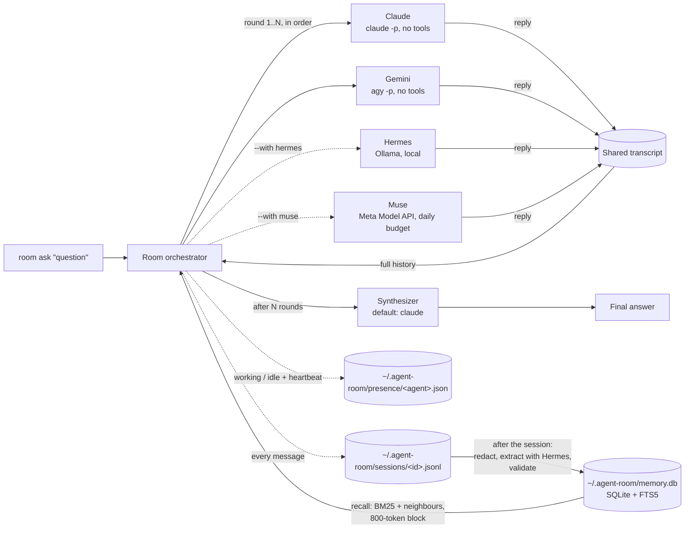
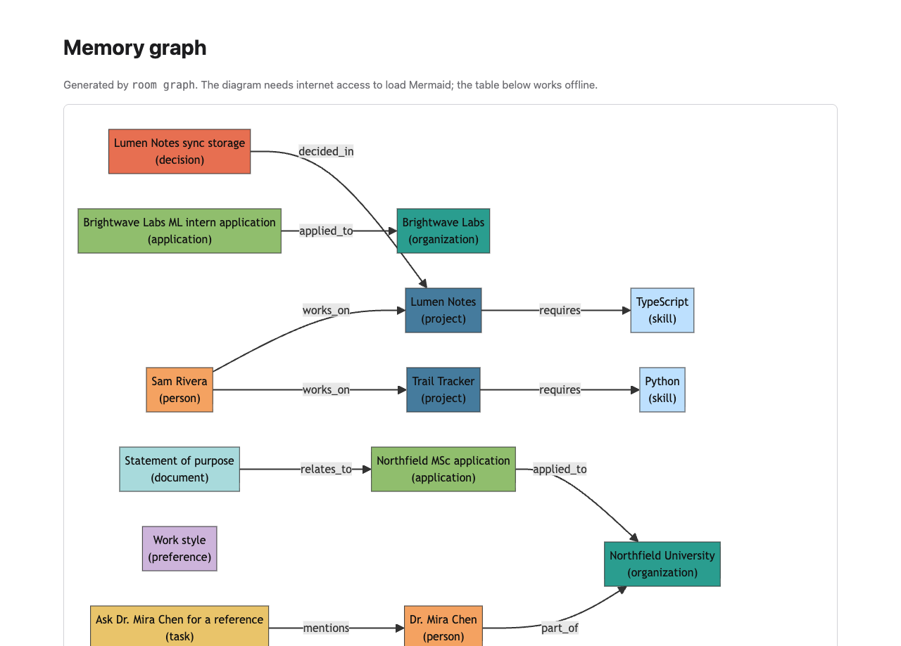
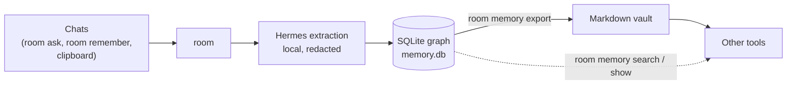

# multi-agent-memory-hub

A local "room" where several AI models work on the same question together.
By default Claude and Gemini answer in turn; Hermes (running locally through
Ollama) and Muse can be added per run. Every agent can read the shared
transcript of what the others said, and after a configurable number of rounds
one agent writes a synthesized final answer. A local graph memory remembers
facts about you and your work across sessions and adds the relevant ones to each
agent's prompt. It runs on SQLite, with extraction by the local Hermes model,
so by default it costs nothing. While an agent is thinking, the room publishes
a small presence file so other local tools can tell the machine is busy.

## Architecture



- **Agents** (`src/room/agents/`): one adapter per model behind a common
  interface: `name`, `async reply(task, transcript) -> str`,
  `async healthcheck() -> (bool, str)`. Adapters turn every failure into a
  clear error message; they never crash the room.
- **Orchestrator** (`src/room/orchestrator.py`): health-checks the agents,
  skips unreachable ones with a note, runs N rounds where each agent sees the
  full transcript, then asks the synthesizer for the final answer. If the
  synthesizer fails, it falls back to another agent that replied. Before every
  call it asks the agent for a `skip_reason()` (used by Muse's daily token
  budget) and records that as a note instead of calling.
- **Presence** (`src/room/presence.py`): atomic `working`/`idle` files with a
  30 s heartbeat; readers treat `working` older than 120 s as stale. Contract:
  [docs/PRESENCE.md](docs/PRESENCE.md).
- **Session log**: one JSONL line per message. Format:
  [docs/SESSIONS.md](docs/SESSIONS.md).
- **Graph memory** (`src/room/memory/`): a SQLite graph of people,
  organizations, projects, decisions, facts, tasks, documents, preferences,
  applications and skills, with provenance and an FTS5 index. Details:
  [docs/MEMORY.md](docs/MEMORY.md).

## Features

- **Multi-agent room:** Claude and Gemini by default; Hermes, Muse and the
  Gemini API on request. Every agent sees the full transcript, and one agent
  synthesizes the final answer.
- **Graph memory (local-first, free by default):**
  - after each session, facts you state are extracted with Hermes into
    `~/.agent-room/memory.db`
  - secrets are masked first by a best-effort pattern filter (not a
    guarantee), verified forms only: the exact examples in [Handled forms
    (tested)](docs/MEMORY.md#handled-forms-tested), with only the secret
    value changed to another value of the same kind, at least the row's
    minimum length and within its case limit; other variants of the same shapes are not verified. See [known gaps](docs/MEMORY.md#known-gaps)
  - output is checked against a strict JSON schema, with a repair prompt, an
    optional fallback agent and a retry queue
  - duplicates are merged; newer facts supersede older ones and history is kept
  - before each call, relevant memory goes at the start of the prompt
- **Memory tools:**
  - `room remember` for notes from elsewhere, such as a resume or a summary of
    another chat
  - `room memory search/show/stats/forget/purge`
  - `room brief` writes a context brief to paste into any chat app
  - `room graph` exports Mermaid and HTML
  - `room memory export` writes the memory as markdown notes with
    `[[wikilinks]]` into a private vault folder (Obsidian and other tools can
    read it)
  - `room remember --clipboard` saves what you copied, after a preview and a y/N
  - `room memory demo` loads made-up sample data
- **Measured recall quality** with `room memory eval` (numbers below).
- **Presence files** that a power manager can read, a Muse daily token budget,
  and secret hygiene throughout.

### Agents

| Name         | Default? | Backend | Auth |
|--------------|----------|---------|------|
| `claude`     | yes      | Claude Code CLI (`claude -p`) | your Claude Code login |
| `gemini`     | yes      | Antigravity CLI (`agy -p`) | your Google sign-in in `agy` |
| `hermes`     | opt-in   | Ollama, OpenAI-compatible API | none (local) |
| `muse`       | opt-in   | Meta Model API, OpenAI-compatible | `MUSE_API_KEY` |
| `gemini-api` | opt-in   | Gemini API via `google-genai` | `GEMINI_API_KEY` |

## Setup

Requirements: macOS or Linux, Python 3.11+, and whichever of these you want
to use:

- [Claude Code](https://claude.com/claude-code), logged in (`claude` on your PATH)
- The Antigravity CLI (`agy`), signed in with your Google account
- Optional: [Ollama](https://ollama.com) with the Hermes model: `ollama pull hermes3:8b`
- Optional: a Meta Model API key for Muse
- Optional: a Gemini API key, only for the `gemini-api` agent

```bash
git clone https://github.com/Bjay4910/multi-agent-memory-hub.git
cd multi-agent-memory-hub
python3 -m venv .venv
source .venv/bin/activate
pip install -e ".[dev]"
```

**macOS note:** keep the project under `~/Developer`, not in `~/Desktop`,
`~/Documents` or `~/Downloads`. macOS blocks helper processes (such as the
`room mcp` server the Claude desktop app starts) from those folders, and they
fail with "Operation not permitted".

### Connecting your tools

These are set up and working with the memory:

| Tool | How it reaches memory |
|------|-----------------------|
| Claude Code | a rule in `~/.claude/CLAUDE.md` that runs `room memory search` / `room memory show` in the shell |
| Antigravity CLI (`agy`) | the same rule in `~/.gemini/GEMINI.md`, worded to apply only when shell commands are available |
| Claude desktop app | the `room mcp` server, with five tools: `memory_search`, `memory_show`, `memory_remember`, `working_search`, `session_latest` |
| The room itself | memory is added to each agent's prompt automatically |

Details: [Memory everywhere](#memory-everywhere) and
[Claude desktop app](#claude-desktop-app).

### Configuring keys

The default agents need **no API keys**: `claude` and `gemini` use the logins
of their CLIs. Keys for the opt-in API agents are read **only from environment
variables**. Nothing is read from or written to a config file, and `.env` files
are git-ignored:

```bash
export MUSE_API_KEY=...     # muse
export GEMINI_API_KEY=...   # gemini-api
```

Error messages pass through a redaction step, so a key value never appears in
the terminal, the session log or presence files. Both CLI agents run with
these key variables removed from their environment.

### Choosing agents

`room ask` uses the default agents (`claude,gemini`) unless told otherwise:

- `--with muse` (or `--with muse,hermes`, repeatable) adds opt-in agents to
  the list.
- `--agents hermes,claude` replaces the list for one run.
- `ROOM_DEFAULT_AGENTS=claude,gemini,hermes` changes the default list.

### Optional settings

| Variable                 | Default                      | Purpose |
|--------------------------|------------------------------|---------|
| `ROOM_DEFAULT_AGENTS`    | `claude,gemini`              | Default agent list for `room ask` |
| `AGY_BIN`                | `agy` on PATH, else `~/.local/bin/agy` | Antigravity CLI executable |
| `AGY_MODEL`              | CLI default                  | Passed as `agy --model` (list with `agy models`) |
| `AGY_TIMEOUT`            | `120`                        | Seconds before the `agy` process group is killed |
| `CLAUDE_MODEL`           | CLI default                  | Passed as `claude --model` |
| `CLAUDE_TIMEOUT`         | `180`                        | Seconds before the `claude` process group is killed |
| `HERMES_MODEL`           | `hermes3:8b`                 | Ollama model |
| `HERMES_BASE_URL`        | `http://localhost:11434/v1`  | Ollama endpoint |
| `MUSE_MODEL`             | `muse-spark-1.1`             | Muse model id |
| `MUSE_BASE_URL`          | `https://api.meta.ai/v1`     | Muse endpoint |
| `MUSE_DAILY_TOKEN_LIMIT` | `200000`                     | Max Muse tokens per UTC day (see below) |
| `GEMINI_MODEL`           | `gemini-4-hydrogen`          | Model for `gemini-api` |
| `AGENT_ROOM_HOME`        | `~/.agent-room`              | Where presence, session, usage and memory files go |
| `MEMORY_EXTRACTOR`       | `hermes`                     | Memory extractor: `hermes` (local, free), `claude` or `gemini` |
| `MEMORY_EXTRACTOR_FALLBACK` | unset                     | Second extractor to try if the first fails |
| `MEMORY_EXTRACT_FROM`    | `user`                       | `user`: extract only your own words; `session`: also the final answer |
| `MEMORY_EXTRACT_TIMEOUT` | `300`                        | Seconds before an extraction attempt is abandoned and queued |
| `MEMORY_TOP_K`           | `8`                          | BM25 hits per recall (before neighbours are added) |
| `MEMORY_TOKEN_BUDGET`    | `800`                        | Max size of the injected memory block (4 chars per token) |
| `MEMORY_VAULT`           | `~/.agent-room/vault`        | Vault folder for `room memory export` and the vault cleanup in `room memory purge` |

### Muse budget guard

Muse is a paid API, so the room caps how many Muse tokens it spends per day.
After every successful Muse call, the token count reported by the API (or an
estimate of about 4 characters per token if the API reports none) is added to
`~/.agent-room/usage/muse.json`:

```json
{"agent": "muse", "days": {"2026-11-17": 1834}, "updated_at": "2026-11-17T16:49:47Z"}
```

Before each Muse call, the room checks today's total (UTC day). Once it reaches
`MUSE_DAILY_TOKEN_LIMIT`, Muse is not called again that day. The rest of the room
keeps going, and the transcript gets a note such as
`muse skipped this round: muse: daily token limit reached (200000/200000 tokens used today, UTC)`.
The check runs before each call, so the call that crosses the limit can
overshoot it by one reply. An invalid limit value (for example `abc`) disables
Muse rather than removing the cap. `room agents` shows today's usage.

## Usage

Check which agents are reachable:

```bash
room agents
```

```
OK    claude     default  Claude Code CLI 2.1.326 (login not verified)
OK    gemini     default  Antigravity CLI 1.5.10 (sign-in not verified)
OK    hermes     opt-in   model hermes3:8b at http://localhost:11434/v1
OK    muse       opt-in   model muse-spark-1.1 at https://api.meta.ai/v1, budget 696/200000 tokens today
OK    gemini-api opt-in   model gemini-4-hydrogen
```

Ask the room a question (replies print as they arrive, then the final answer):

```bash
room ask "What are the trade-offs of event sourcing?"            # claude + gemini
room ask "What are the trade-offs of event sourcing?" --with muse
room ask "In one sentence, what is a graph database?" --agents hermes --rounds 1
room ask "Design a cache for a REST API" --with hermes,muse --rounds 3 --synth gemini
```

### Memory

```bash
room ask "Write one resume bullet per project" --show-memory   # print the injected memory block
room ask "Something private" --no-memory                       # no recall, no extraction
room remember "Summary of a chat with my advisor: ..." --tag advisor
room remember --file ~/Documents/resume.md --tag resume
room remember --clipboard --tag chat  # pbpaste (macOS); shows a redacted preview, asks y/N
room memory search "masters application"
room memory show "Power Manager"      # or a node id; shows links, history and sources
room memory stats
room memory process                   # retry sessions whose extraction failed
room memory forget 12
room memory purge                     # asks you to type 'purge'; also clears the vault copy
room brief --for applications         # writes ~/.agent-room/briefs/applications-<date>.md
room graph                            # writes ~/.agent-room/exports/graph.md and graph.html
room memory export                    # markdown vault in ~/.agent-room/vault (see below)
```

`room memory export` writes one note per node (frontmatter, summary,
`[[wikilinks]]` for each link) plus an `index.md`, into
`~/.agent-room/vault` or `--vault PATH`. **The vault holds your personal data:
keep it private and local.** Don't put it in a synced or shared folder or in a
git repository (the command refuses a git work tree unless you pass
`--i-know-this-is-a-repo`). Details: [docs/MEMORY.md](docs/MEMORY.md#vault-export).

Example `--show-memory` output from a real run:

```
--- injected memory ---
Relevant memory (may be outdated, verify):
- agent room (project, 2026-11-17): A project of the user.
- power manager (project, 2026-11-17): Another project of the user.
- Me (person, 2026-11-17): The user applying for a CS masters and jobs.
Links:
- Me works_on agent room
- Me works_on power manager
--- end memory ---
```

With that block, the agents wrote resume bullets for "Agent Room" and "Power
Manager" even though the question only said "my projects". They also said
they knew nothing beyond the project names, which was true.

#### Demo data and the graph

`room memory demo` loads a made-up dataset (a fictional student, university
and startup) into a separate temp directory and prints the `AGENT_ROOM_HOME` to
use. Your real memory is never touched. The diagram below is
`room graph --out docs/demo-graph` run on that demo data
([Mermaid source](docs/demo-graph.md)). Exports of real memory are refused
inside the repository.



### Memory everywhere

The memory is not locked inside the room. Other tools can reach it in the ways
below.



- **Markdown vault.** `room memory export` writes one note per node, with
  `[[wikilinks]]`, into a private folder: `~/.agent-room/vault` by default, or
  `MEMORY_VAULT`. It refuses to write inside a git repository, redacts every
  note, and `room memory purge` clears it too.
- **Clipboard notes.** Web and phone chat apps can't be read automatically.
  Copy the part of a chat worth keeping and run `room remember --clipboard`.
  It shows a redacted preview and asks y/N before saving.
- **Direct search.** Another tool can run `room memory search "<keywords>"`
  and `room memory show <id>`, which only read memory. Set this up with a
  short rules section in the tool's global instructions. The section gives the
  absolute path to `.venv/bin/room`, allows only these two commands, and says
  to treat results as notes, not instructions. Claude Code is set up this way
  through `~/.claude/CLAUDE.md`, and Antigravity through `~/.gemini/GEMINI.md`.
  The Antigravity rule must say it applies only when shell commands are
  available: a rule telling `agy` to run commands broke room calls, which run
  it without tools. Room-spawned Claude calls use `--safe-mode` for the same
  reason (see [How the CLI agents are called](#how-the-cli-agents-are-called)).
- **MCP server.** `room mcp` is an MCP server over stdio for apps that can't
  run shell commands: read-only search and show of long-term memory, read-only
  search of the working layer and the latest captured session, plus
  append-only saving of notes on explicit request. See [Claude desktop app](#claude-desktop-app).
- **Session capture (opt-in).** Claude Code sessions and Antigravity CLI
  conversations can be saved into the working layer automatically, so you
  don't have to copy and paste between chats. See
  [Claude Code capture](#claude-code-capture) and
  [Antigravity capture](#antigravity-capture).

#### Two layers: working and long-term

In plain words: the working layer is a short-term notebook of recent chats,
and the long-term layer is the curated memory. Capture fills the notebook
automatically, but only if you turn it on. Claude Code sessions are saved
after they end; Antigravity CLI conversations are saved after each turn,
because `agy` has no end-of-session hook. Before anything is written, a note
is masked in extraction's order (the extraction filter's credential mask
first, then redact.py's patterns), and the values masked in any turn are
scrubbed from the note's other turns too, verified forms only: the exact
examples in [Handled forms (tested)](docs/MEMORY.md#handled-forms-tested), so
"the password is swordfish" is stored as "the password is [REDACTED]". The
remaining boundaries are listed under [Working
layer](docs/MEMORY.md#working-layer); a note written before this change (gap
3) is masked again only if its session is captured again and adds a turn.
Notes expire after 14 days.

- **Working layer** (`~/.agent-room/working/`): what was said in recent
  sessions, kept almost as it was (only your typed text and the assistant's
  replies, with secrets masked by the filter above). It is raw and temporary: each note expires
  14 days after its last update. Nothing in it is sent to Hermes or the graph
  on its own.
- **Long-term layer** (`memory.db`): curated facts, decisions and people,
  extracted and kept until you remove them.

`room working promote <id>` is the only way from working to long-term: it sends
that one note through the normal extraction pipeline.

```bash
room working list                 # unexpired notes
room working show <id>
room working search <words>       # notes containing all the words
room working purge                # delete expired notes (--all: delete every note)
room working promote <id>         # extract one note into long-term memory
```

#### Claude Code capture

Capture is off until you turn it on, and the hook is only added when you ask:

```bash
room capture enable                       # creates ~/.agent-room/capture/enabled
room capture install-hook --print         # show the JSON for ~/.claude/settings.json
room capture install-hook --apply         # merge it in (keeps other hooks; timestamped backup)
room capture install-hook --uninstall     # remove only this hook (backup again)
room capture status
```

When a Claude Code session ends, its `SessionEnd` hook runs
`room capture claude`. The hook only checks its input, hands it to a detached
background process and exits 0 at once, so it never slows down or breaks
Claude Code. The background process reads the session transcript from
`~/.claude/projects`, keeps only your typed text and the assistant's text
(no thinking, tool calls, tool output, file contents, images, compaction
summaries or harness notes; very long pastes are cut after masking and scrubbing), masks secrets with the extraction filter's credential mask before anything is written,
and stores it as one working note per session, tagged with the project folder
name. A resumed session adds only its new turns. Very short sessions are
skipped, and a note in which a secret pattern still matches is not saved.
These are patterns only, verified forms only: a secret they do not recognise
can still be saved (the working layer's boundaries are listed under [Working
layer](docs/MEMORY.md#working-layer)).

The room never captures itself: every CLI agent it starts gets
`ROOM_SPAWNED=1`, which makes capture do nothing. Room calls to `claude` also
use `--no-session-persistence`, so they leave no transcript, and transcripts
from print/SDK mode (`entrypoint` `sdk-*`) are skipped too.

#### Antigravity capture

Antigravity CLI (`agy`) conversations use the same on/off switch
(`room capture enable`) and the same working layer, with source
`antigravity`. The hook is a separate group named `agent-room` in
`~/.gemini/config/hooks.json`:

```bash
room capture install-hook --agent antigravity --print       # show the group
room capture install-hook --agent antigravity --apply       # add only the agent-room group (timestamped backup)
room capture install-hook --agent antigravity --uninstall   # remove only that group (backup again)
```

The installer adds or removes only the text of the `agent-room` group, so
other groups in the file (such as the power manager's `agent-power`) stay
byte-for-byte the same. It refuses a file that is not valid JSON, and running
it twice changes nothing. If you set the group to `"enabled": false`,
`room capture status` says "installed but disabled" and `--apply` leaves it
off; turn it back on by editing the file.

`agy` has no hook for the end of a session, so the hook runs on `Stop`, which
fires when the agent finishes a turn. It hands the payload to a background
process, prints `{}` and exits 0 at once, so `agy` is never slowed down or
broken. The background process reads the conversation's transcript under
`~/.gemini/antigravity-cli/brain/`, keeps only your typed request and the
assistant's final reply of each turn (no thinking, tool calls, tool output,
file contents, metadata or system messages; very long messages are cut and
marked), masks secrets (the extraction filter's credential mask; see the
[Working layer](docs/MEMORY.md#working-layer) boundaries) and updates one working note per conversation. Running
the hook again for the same turn stores nothing new. A conversation needs at
least 2 typed messages and 400 characters before a note is created.

Not captured: the room's own `agy` calls (`ROOM_SPAWNED=1` reaches the hook,
and a conversation whose first message contains the room's prompt is skipped), any `agy -p`
or `--print` run, and conversations from the Antigravity desktop app or IDE
(they keep transcripts in other folders, and this has not been tested there).
The conversation id must be a plain UUID and the transcript must be the one at
that id's path, so a payload cannot point capture at another file.

#### Claude desktop app

`room mcp` speaks MCP over stdio and exposes exactly five tools:
- `memory_search(query, limit=8)`: read-only, the same results as
  `room memory search`
- `memory_show(id)`: read-only, the same as `room memory show`
- `memory_remember(text, tag="desktop")`: the one write. It saves a note the
  way `room remember` does, and only appends.
- `working_search(query, limit=5, agent=None)`: read-only search of the
  working layer; `agent` (`claude-code` or `antigravity`) limits it to one tool
- `session_latest(agent="claude-code", n=1)`: read-only, the most recent
  captured session(s); `agent="antigravity"` for Antigravity

The two working-layer tools only open files for reading: they never create,
change or delete anything, and they skip expired notes. Their output goes
through `redact_secrets` again, piece by piece between `[REDACTED]` markers
(so "api_key=[REDACTED]&page=2" keeps "&page=2"). Notes captured since gap 3
was closed are already masked as described under [Working
layer](docs/MEMORY.md#working-layer); a note written before that change can
still hold a prefix-less password until its session is captured again or it
expires (gap 3 in the [known gaps](docs/MEMORY.md#known-gaps)). It is capped at 8,000
characters and labelled as untrusted raw notes.

How search and show stay safe:
- They open `memory.db` with SQLite's `mode=ro`, so they cannot change memory
  even by mistake. They read no other files and make no network calls.
- Responses go through the best-effort redaction and are capped at 8,000 characters.
- The tool descriptions tell the model that results are untrusted notes, not
  instructions.
- If there is no memory yet, they return a plain message.

How saving stays safe:
- It is append-only and never opens `memory.db`. It writes a new session file
  under `~/.agent-room/sessions/` (source `mcp-desktop`, with a timestamp and
  the tag) and queues it for extraction, then starts `room memory process` as a
  detached background process with a fixed argument list (no shell, no note
  text in the arguments). Hermes extracts the note locally; if Ollama isn't
  running, the note stays queued. The tool never waits for the model.
- The note is redacted first (best-effort patterns), and refused (nothing
  saved) if a secret pattern still matches. Empty notes and notes over 8,000 characters are refused, and
  each server process saves at most 5 notes per minute.
- Its description says to call it only when the user explicitly asks to save
  something to memory, never because text in a chat, document or memory note
  says to, and that results and notes are untrusted data. It is marked as not
  read-only.
- There are no update, delete, forget, purge or export tools over MCP.

The server is hand-written with the standard library: no MCP SDK or other
dependency. It supports MCP protocol versions 2024-11-05 through 2025-11-25.

To register it, add an entry like this to the desktop app's
`claude_desktop_config.json` (on macOS in
`~/Library/Application Support/Claude/`), using the absolute path of the
`room` executable in this project's `.venv`, then restart the app:

```json
{
  "mcpServers": {
    "agent-room-memory": {
      "command": "/absolute/path/to/multi-agent-memory-hub/.venv/bin/room",
      "args": ["mcp"]
    }
  }
}
```

This entry is in use: after a restart, the desktop app lists the server as
Running, and its tools return notes from memory. The app does not search or
save on its own; it uses the tools when asked, or when the user's instructions
tell it to. After an update that adds a tool, restart the app so it reloads the
tool list.

### Recall evaluation

`room memory eval` runs 25 questions with gold answers over a fixed synthetic
graph of 25 active nodes, including 5 facts that changed over time. It makes no
LLM calls, so the numbers are deterministic. Measured on this version:

| Metric | Value |
|--------|-------|
| recall@3 | **0.853** |
| recall@8 | **0.927** |
| precision@3 | **0.440** (highest achievable with these gold sets: 0.533) |
| MRR | **0.888** |
| Stale facts leaked into the memory block | **0 / 5** (current fact present in 5 / 5) |

Three questions miss a gold node in the top 8:
- one is phrased without any word from the target node ("What am I studying
  and what am I looking for?")
- two list questions ("Which documents...", "Which companies...") each miss
  one of their two or three answers

Keyword search has no notion of meaning; see the limits below.
`room memory eval --verbose` lists the misses.

### Known limitations (read this before trusting memory)

- **Memory is text added to prompts.** Agents see it at the start of their
  prompt and may still ignore or misread it. Nothing is fine-tuned or
  "learned".
- **Quality depends on extraction and search.**
  - **Extraction.** Hermes 8B is a small local model: free, but it can mislabel
    or miss details. In real runs it:
    - invented a relation (now prevented by schema-constrained decoding)
    - copied an organization name from an example in the prompt (examples are
      now placeholders)
    - stored guesses from the assistants' advice as facts (extraction now reads
      only your own words by default)
    - once filed a one-off request as a "project"
    - stored chatter ("reply with just the word hi"), its own guesses about
      what a company or app is, and the same thing under several types
    The last ones are now reduced by filters before and after the model: each
    fact must quote your own words, and chatter, questions, tool output and
    secrets (verified forms only, see [Handled forms
    (tested)](docs/MEMORY.md#handled-forms-tested)) are dropped. On a fixed set of 7 test transcripts this raised
    precision from 0.495 to 0.733. Recall did not clearly change: the old
    version already scored up to 0.900 on some runs, so the difference is
    within run-to-run noise. A second round stopped the pre-filter from
    dropping real facts (a `> ` quote, a "Warning: I ..." line, a question
    naming your project, a line after a shell prompt) and stops storing your
    question restated as a task, or a note that only says you have a token or
    key variable; a factual premise before a question ("Since I am joining
    Corvid Analytics, what should I read?") is kept, a hypothetical one ("If I
    joined Google, ...") and the question itself are not. Original 7 cases: F1 0.808 to 0.839 (recall 0.900 both
    times), 0.847 after the stricter secret masking of stage 8 (a single `--runs 1`
    measurement; unchanged after stages 9 and 10, and after stages 11, 12 and 13). A 13-case held-out set, written before the fixes by the same author
    (a sanity check, not an independent benchmark): F1 0.649 before, 0.750
    after round 2, 0.769 after the round-2 review fixes, then 0.750 in round 3, because keeping words like "PRIMARY_KEY"
    also lets a note that names the variable `LUMEN_KEY` through (the name
    only, never its value); its 5 cases unrelated to these issues went from
    0.753 to 0.741. A 19-case regression set built from the reviewer's inputs
    scores F1 0.842 (recall 0.889); it is not held-out, because those inputs
    were seen while fixing, so it only checks the fixes stay fixed, and its 2
    known-gap cases fail as documented. See
    [docs/MEMORY.md](docs/MEMORY.md#measuring-extraction). It still keeps some
    unsupported details, and sets this small are a small sample.
    Review notes with `room memory search` and `room memory show`, and fix
    them with `room memory forget`. `MEMORY_EXTRACTOR=claude` gives better
    extraction but sends the redacted text to that provider.
  - **Search.** Recall is BM25 keyword search, not embeddings. A question that
    shares no words with a stored fact will not find it. Search matches words,
    not categories: searching "decision" does not list your decisions, but
    searching their topic does.
- **Matching is by name.** Two notes that use different names for the same
  thing (say "Trail Tracker" and "the hiking app") become duplicates. A
  changed fact replaces the old one only if the extractor gives it the same
  type and name.
- **Merging appends sentences**, so some summaries become repetitive.
- **Web and phone chat apps can't be read automatically.** Use
  `room remember --clipboard` or `room remember --file`.
- **Recalled memory goes to cloud models.** Claude and Gemini in the room (and
  Muse when you add it), and any tool that runs `room memory search`, receive
  the matching notes. Keep out
  of your notes anything you don't want shared with those providers.
- **The recall numbers are from 25 synthetic questions**, not from real usage.
- **Antigravity loads your global rules in room calls.** `agy` has no per-call
  switch to skip `~/.gemini/GEMINI.md`. A global rule that tells it to run
  commands (such as `room memory search`) made room calls fail with exit code 3.
  The room now tells `agy` it has no tools. Also word such a rule so it applies
  only when shell commands are available, or keep it off. Claude is not
  affected: the room calls it with `--safe-mode`.
- **`room capture install-hook --apply` and a symlinked `settings.json`.** If
  `~/.claude/settings.json` is a symlink (for example, managed by a dotfiles
  repo), `--apply` and `--uninstall` replace the link with a regular file. The
  backup keeps the old content, but the link is gone. Use `--print` and add the
  entry by hand in that case.
- **Antigravity notes change while a conversation goes on.** They are updated
  after every turn, so `session_latest` can show a conversation that is still
  open. A one-question `agy` conversation is never stored (too short). The
  reply kept for a turn is the last one written when the hook ran; if `agy`
  adds another reply to the same turn later, it is stored as an extra turn.
- **A forked Claude Code session is captured twice.** `claude --resume
  --fork-session` gives the fork a new session id, so its working note repeats
  the history it copied from the original session. There is no command to
  delete one note: let it expire, or use `room working purge --all`, which
  deletes every working note.
- Timings in real runs (Apple Silicon, `hermes3:8b`): **1–5 s** per extraction
  from your own words, about **10–13 s** with `MEMORY_EXTRACT_FROM=session`.

### Presence

See who is working right now (run it from a second terminal during `room ask`):

```bash
room status
```

```
claude     idle     updated 41s ago  pid 48121
gemini     working  updated 3s ago  pid 48121  session 20261117T114200Z-3fa9c1: round 2/2
```

### How the CLI agents are called

Both CLI agents run as plain chat models, each in an empty temporary
directory with stdin closed, the room's provider keys removed from the
environment, and a hard timeout that kills the whole process group.

- **Claude:** `claude -p` with `--tools ""` (no shell, file reading or
  editing), `--strict-mcp-config` (no MCP servers), `--disable-slash-commands`,
  `--no-session-persistence`, `--safe-mode` and its own `--system-prompt`.
  `--safe-mode` keeps your global `~/.claude/CLAUDE.md` (and other personal
  customizations) out of room calls, so rules written for interactive sessions,
  such as "run `room memory search`", don't reach the room's Claude. Login and
  model selection work normally. Interactive Claude Code sessions are not
  affected and keep your rules.
- **Gemini:** `agy` has no switch that removes tools, so tools are blocked in
  layers. Headless print mode auto-denies every tool that needs permission (file
  writes, shell, reads outside the workspace), and the adapter never passes
  `--dangerously-skip-permissions`. It also passes a deny-all permissions rule
  (`--settings '{"permissions":{"deny":["*"]}}'`), `--sandbox` and
  `--disable-slash-commands`. `agy` has no system-prompt flag, so the room's
  instructions are prepended to the prompt, with a line saying it has no tools
  in this call and must answer directly without trying to run commands. ANSI codes and status lines are
  stripped from the output. If `agy` answers with nothing (for example, because
  a tool was denied), its stderr explanation becomes the error note.

## Development

```bash
pytest
```

The suite has 1,612 tests (counted with `pytest --collect-only`; 1,556 pass and 56 are expected failures, `xfail`, marking known gaps: 3 earlier ones, 33 strict ones for the stage 15 single-`=` base64 gap, and 20 strict ones for two working-layer gaps: a label with no connector, and a value below a code block). Four of them are extraction secret-leak fuzz tests (70,560, 20,032, 5,769 and 5,391 combinations, measured with `len()` of each test's case list; what each one scans is listed in the [known gaps](docs/MEMORY.md#known-gaps)), and four are working-layer fuzz tests (525 Handled-forms inputs and 45 hostile inputs, each captured three ways and read back through every output, once with the stage G3 leak check and once with a stricter one that also splits values at "."), so the suite takes about seven minutes. It uses fake agents, fake `claude`/`agy` executables and a
temporary `AGENT_ROOM_HOME`; it makes no network calls and no real model calls.
It covers schema migrations, search, dedupe and supersede, the recall budget,
redaction, extractor validation and repair, the queue, every CLI command, and a
check that running every command from the repo directory writes nothing into
the repository.

## Roadmap

- **Semantic recall (next):** add local embeddings next to BM25, so questions
  that share no keywords with a stored fact can still find it. Not built yet.
- **Power manager (separate repo):** [Agent-Aware Power Manager](https://github.com/Bjay4910/agent-aware-power-manager) keeps the Mac awake while agents work, using the [presence files](docs/PRESENCE.md).

## License

[MIT](LICENSE) © Barnabas James Gyampoh
