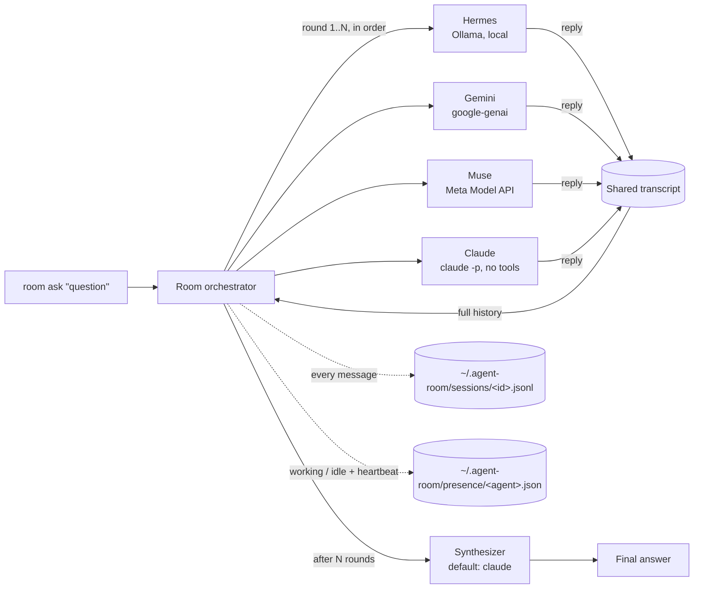

# multi-agent-memory-hub

A local "room" where several AI models work on the same question together.
Hermes (running locally through Ollama), Gemini, Muse and Claude each answer
in turn, every agent can read the shared transcript of what the others said,
and after a configurable number of rounds one agent writes a synthesized final
answer. While an agent is thinking, the room publishes a small presence file
so other local tools can tell the machine is busy, and every message is saved
to a JSON Lines session log that a future graph-memory layer will ingest.

## Architecture



- **Agents** (`src/room/agents/`): one adapter per model behind a common
  interface: `name`, `async reply(task, transcript) -> str`,
  `async healthcheck() -> (bool, str)`. Adapters turn every failure into a
  clear error message; they never crash the room.
- **Orchestrator** (`src/room/orchestrator.py`): health-checks the agents,
  skips unreachable ones with a note, runs N rounds where each agent sees the
  full transcript, then asks the synthesizer for the final answer. If the
  synthesizer fails, it falls back to another agent that replied.
- **Presence** (`src/room/presence.py`): atomic `working`/`idle` files with a
  30 s heartbeat; readers treat `working` older than 120 s as stale. Contract:
  [docs/PRESENCE.md](docs/PRESENCE.md).
- **Session log**: one JSONL line per message. Format:
  [docs/SESSIONS.md](docs/SESSIONS.md).

## Setup

Requirements: macOS or Linux, Python 3.11+, and whichever of these you want
to use:

- [Ollama](https://ollama.com) with the Hermes model: `ollama pull hermes3:8b`
- A Gemini API key (Google AI Studio)
- A Meta Model API key for Muse
- [Claude Code](https://claude.com/claude-code), logged in (`claude` on your PATH)

```bash
git clone https://github.com/Bjay4910/multi-agent-memory-hub.git
cd multi-agent-memory-hub
python3 -m venv .venv
source .venv/bin/activate
pip install -e ".[dev]"
```

### Configuring keys

Keys are read **only from environment variables**. Nothing is read from or
written to a config file, and `.env` files are git-ignored. Export them in your
shell (or your shell profile, or a secrets manager):

```bash
export GEMINI_API_KEY=...   # Gemini
export MUSE_API_KEY=...     # Muse
```

Claude needs no key: the adapter calls the `claude` CLI, which uses your
existing Claude Code login. Hermes needs no key either.

Error messages pass through a redaction step, so a key value never appears in
the terminal, the session log or presence files.

### Optional settings

| Variable          | Default                      | Purpose |
|-------------------|------------------------------|---------|
| `GEMINI_MODEL`    | `gemini-4-hydrogen`          | Gemini model id |
| `MUSE_MODEL`      | `muse-spark-1.1`             | Muse model id |
| `MUSE_BASE_URL`   | `https://api.meta.ai/v1`     | Muse endpoint |
| `HERMES_MODEL`    | `hermes3:8b`                 | Ollama model |
| `HERMES_BASE_URL` | `http://localhost:11434/v1`  | Ollama endpoint |
| `CLAUDE_MODEL`    | CLI default                  | Passed as `claude --model` |
| `CLAUDE_TIMEOUT`  | `180`                        | Seconds before the Claude CLI call is killed |
| `AGENT_ROOM_HOME` | `~/.agent-room`              | Where presence and session files go |

## Usage

Check which agents are reachable:

```bash
room agents
```

```
OK    hermes  model hermes3:8b at http://localhost:11434/v1
OK    gemini  model gemini-4-hydrogen
OK    muse    model muse-spark-1.1 at https://api.meta.ai/v1
OK    claude  Claude Code CLI 2.1.326 (login not verified)
```

Ask the room a question (replies print as they arrive, then the final answer):

```bash
room ask "What are the trade-offs of event sourcing?"
room ask "In one sentence, what is a graph database?" --agents hermes --rounds 1
room ask "Design a cache for a REST API" --agents hermes,gemini,claude --rounds 3 --synth gemini
```

See who is working right now (run it from a second terminal during `room ask`):

```bash
room status
```

```
claude  idle     updated 41s ago  pid 48121
gemini  working  updated 3s ago  pid 48121  session 20261117T114200Z-3fa9c1: round 2/2
hermes  idle     updated 12s ago  pid 48121
```

### How Claude is called

The Claude adapter runs `claude -p` as a plain chat model: `--tools ""` (no
shell, file reading or editing), `--strict-mcp-config` (no MCP servers),
`--disable-slash-commands`, `--no-session-persistence`, and its own
`--system-prompt`. It runs in an empty temporary directory, with the room's
provider keys removed from its environment, and is killed after
`CLAUDE_TIMEOUT` seconds.

## Development

```bash
pytest
```

The test suite uses fake agents and a temporary `AGENT_ROOM_HOME`; it makes no
network calls and no real model calls.

## Roadmap

- **Graph memory (next):** ingest the session logs into a graph so agents can
  recall facts and past discussions across sessions. Not built yet.
- **Presence-driven power manager (separate repo):** reads the presence files
  described in [docs/PRESENCE.md](docs/PRESENCE.md) to keep the machine awake
  while agents are working. Not built yet.

## License

[MIT](LICENSE) © Barnabas James Gyampoh
