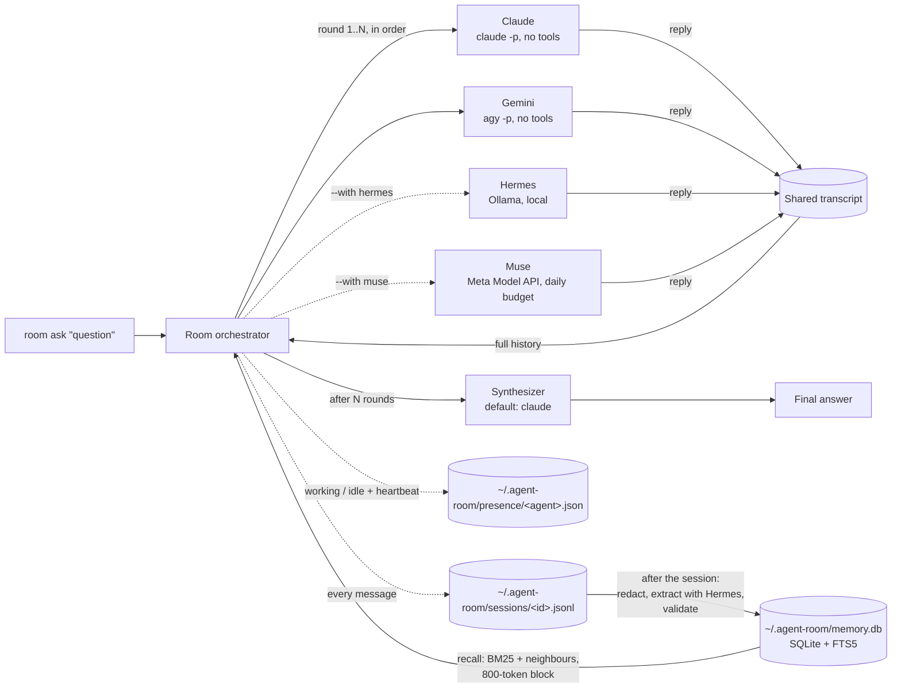
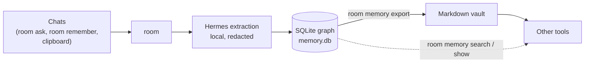

# multi-agent-memory-hub

A local "room" where several AI models work on the same question together.
By default Claude and Gemini answer in turn; Hermes (running locally through
Ollama) and Muse can be added per run. Every agent can read the shared
transcript of what the others said, and after a configurable number of rounds
one agent writes a synthesized final answer. A local graph memory remembers
facts about you and your work across sessions and adds the relevant ones to each
agent's prompt. It runs on SQLite, with extraction by the local Hermes model,
so by default it costs nothing. While an agent is thinking, the room publishes
a small presence file so other local tools can tell the machine is busy.

## Architecture



- **Agents** (`src/room/agents/`): one adapter per model behind a common
  interface: `name`, `async reply(task, transcript) -> str`,
  `async healthcheck() -> (bool, str)`. Adapters turn every failure into a
  clear error message; they never crash the room.
- **Orchestrator** (`src/room/orchestrator.py`): health-checks the agents,
  skips unreachable ones with a note, runs N rounds where each agent sees the
  full transcript, then asks the synthesizer for the final answer. If the
  synthesizer fails, it falls back to another agent that replied. Before every
  call it asks the agent for a `skip_reason()` (used by Muse's daily token
  budget) and records that as a note instead of calling.
- **Presence** (`src/room/presence.py`): atomic `working`/`idle` files with a
  30 s heartbeat; readers treat `working` older than 120 s as stale. Contract:
  [docs/PRESENCE.md](docs/PRESENCE.md).
- **Session log**: one JSONL line per message. Format:
  [docs/SESSIONS.md](docs/SESSIONS.md).
- **Graph memory** (`src/room/memory/`): a SQLite graph of people,
  organizations, projects, decisions, facts, tasks, documents, preferences,
  applications and skills, with provenance and an FTS5 index. Details:
  [docs/MEMORY.md](docs/MEMORY.md).

## Features

- **Multi-agent room:** Claude and Gemini by default; Hermes, Muse and the
  Gemini API on request. Every agent sees the full transcript, and one agent
  synthesizes the final answer.
- **Graph memory (local-first, free by default):**
  - after each session, facts you state are extracted with Hermes into
    `~/.agent-room/memory.db`
  - secrets are redacted first
  - output is checked against a strict JSON schema, with a repair prompt, an
    optional fallback agent and a retry queue
  - duplicates are merged; newer facts supersede older ones and history is kept
  - before each call, relevant memory goes at the start of the prompt
- **Memory tools:**
  - `room remember` for notes from elsewhere, such as a resume or a summary of
    another chat
  - `room memory search/show/stats/forget/purge`
  - `room brief` writes a context brief to paste into any chat app
  - `room graph` exports Mermaid and HTML
  - `room memory export` writes the memory as markdown notes with
    `[[wikilinks]]` into a private vault folder (Obsidian and other tools can
    read it)
  - `room remember --clipboard` saves what you copied, after a preview and a y/N
  - `room memory demo` loads made-up sample data
- **Measured recall quality** with `room memory eval` (numbers below).
- **Presence files** that a power manager can read, a Muse daily token budget,
  and secret hygiene throughout.

### Agents

| Name         | Default? | Backend | Auth |
|--------------|----------|---------|------|
| `claude`     | yes      | Claude Code CLI (`claude -p`) | your Claude Code login |
| `gemini`     | yes      | Antigravity CLI (`agy -p`) | your Google sign-in in `agy` |
| `hermes`     | opt-in   | Ollama, OpenAI-compatible API | none (local) |
| `muse`       | opt-in   | Meta Model API, OpenAI-compatible | `MUSE_API_KEY` |
| `gemini-api` | opt-in   | Gemini API via `google-genai` | `GEMINI_API_KEY` |

## Setup

Requirements: macOS or Linux, Python 3.11+, and whichever of these you want
to use:

- [Claude Code](https://claude.com/claude-code), logged in (`claude` on your PATH)
- The Antigravity CLI (`agy`), signed in with your Google account
- Optional: [Ollama](https://ollama.com) with the Hermes model: `ollama pull hermes3:8b`
- Optional: a Meta Model API key for Muse
- Optional: a Gemini API key, only for the `gemini-api` agent

```bash
git clone https://github.com/Bjay4910/multi-agent-memory-hub.git
cd multi-agent-memory-hub
python3 -m venv .venv
source .venv/bin/activate
pip install -e ".[dev]"
```

### Configuring keys

The default agents need **no API keys**: `claude` and `gemini` use the logins
of their CLIs. Keys for the opt-in API agents are read **only from environment
variables**. Nothing is read from or written to a config file, and `.env` files
are git-ignored:

```bash
export MUSE_API_KEY=...     # muse
export GEMINI_API_KEY=...   # gemini-api
```

Error messages pass through a redaction step, so a key value never appears in
the terminal, the session log or presence files. Both CLI agents run with
these key variables removed from their environment.

### Choosing agents

`room ask` uses the default agents (`claude,gemini`) unless told otherwise:

- `--with muse` (or `--with muse,hermes`, repeatable) adds opt-in agents to
  the list.
- `--agents hermes,claude` replaces the list for one run.
- `ROOM_DEFAULT_AGENTS=claude,gemini,hermes` changes the default list.

### Optional settings

| Variable                 | Default                      | Purpose |
|--------------------------|------------------------------|---------|
| `ROOM_DEFAULT_AGENTS`    | `claude,gemini`              | Default agent list for `room ask` |
| `AGY_BIN`                | `agy` on PATH, else `~/.local/bin/agy` | Antigravity CLI executable |
| `AGY_MODEL`              | CLI default                  | Passed as `agy --model` (list with `agy models`) |
| `AGY_TIMEOUT`            | `120`                        | Seconds before the `agy` process group is killed |
| `CLAUDE_MODEL`           | CLI default                  | Passed as `claude --model` |
| `CLAUDE_TIMEOUT`         | `180`                        | Seconds before the `claude` process group is killed |
| `HERMES_MODEL`           | `hermes3:8b`                 | Ollama model |
| `HERMES_BASE_URL`        | `http://localhost:11434/v1`  | Ollama endpoint |
| `MUSE_MODEL`             | `muse-spark-1.1`             | Muse model id |
| `MUSE_BASE_URL`          | `https://api.meta.ai/v1`     | Muse endpoint |
| `MUSE_DAILY_TOKEN_LIMIT` | `200000`                     | Max Muse tokens per UTC day (see below) |
| `GEMINI_MODEL`           | `gemini-4-hydrogen`          | Model for `gemini-api` |
| `AGENT_ROOM_HOME`        | `~/.agent-room`              | Where presence, session, usage and memory files go |
| `MEMORY_EXTRACTOR`       | `hermes`                     | Memory extractor: `hermes` (local, free), `claude` or `gemini` |
| `MEMORY_EXTRACTOR_FALLBACK` | unset                     | Second extractor to try if the first fails |
| `MEMORY_EXTRACT_FROM`    | `user`                       | `user`: extract only your own words; `session`: also the final answer |
| `MEMORY_EXTRACT_TIMEOUT` | `300`                        | Seconds before an extraction attempt is abandoned and queued |
| `MEMORY_TOP_K`           | `8`                          | BM25 hits per recall (before neighbours are added) |
| `MEMORY_TOKEN_BUDGET`    | `800`                        | Max size of the injected memory block (4 chars per token) |
| `MEMORY_VAULT`           | `~/.agent-room/vault`        | Vault folder for `room memory export` and the vault cleanup in `room memory purge` |

### Muse budget guard

Muse is a paid API, so the room caps how many Muse tokens it spends per day.
After every successful Muse call, the token count reported by the API (or an
estimate of about 4 characters per token if the API reports none) is added to
`~/.agent-room/usage/muse.json`:

```json
{"agent": "muse", "days": {"2026-11-17": 1834}, "updated_at": "2026-11-17T16:49:47Z"}
```

Before each Muse call, the room checks today's total (UTC day). Once it reaches
`MUSE_DAILY_TOKEN_LIMIT`, Muse is not called again that day. The rest of the room
keeps going, and the transcript gets a note such as
`muse skipped this round: muse: daily token limit reached (200000/200000 tokens used today, UTC)`.
The check runs before each call, so the call that crosses the limit can
overshoot it by one reply. An invalid limit value (for example `abc`) disables
Muse rather than removing the cap. `room agents` shows today's usage.

## Usage

Check which agents are reachable:

```bash
room agents
```

```
OK    claude     default  Claude Code CLI 2.1.326 (login not verified)
OK    gemini     default  Antigravity CLI 1.5.10 (sign-in not verified)
OK    hermes     opt-in   model hermes3:8b at http://localhost:11434/v1
OK    muse       opt-in   model muse-spark-1.1 at https://api.meta.ai/v1, budget 696/200000 tokens today
OK    gemini-api opt-in   model gemini-4-hydrogen
```

Ask the room a question (replies print as they arrive, then the final answer):

```bash
room ask "What are the trade-offs of event sourcing?"            # claude + gemini
room ask "What are the trade-offs of event sourcing?" --with muse
room ask "In one sentence, what is a graph database?" --agents hermes --rounds 1
room ask "Design a cache for a REST API" --with hermes,muse --rounds 3 --synth gemini
```

### Memory

```bash
room ask "Write one resume bullet per project" --show-memory   # print the injected memory block
room ask "Something private" --no-memory                       # no recall, no extraction
room remember "Summary of a chat with my advisor: ..." --tag advisor
room remember --file ~/Documents/resume.md --tag resume
room remember --clipboard --tag chat  # pbpaste (macOS); shows a redacted preview, asks y/N
room memory search "masters application"
room memory show "Power Manager"      # or a node id; shows links, history and sources
room memory stats
room memory process                   # retry sessions whose extraction failed
room memory forget 12
room memory purge                     # asks you to type 'purge'; also clears the vault copy
room brief --for applications         # writes ~/.agent-room/briefs/applications-<date>.md
room graph                            # writes ~/.agent-room/exports/graph.md and graph.html
room memory export                    # markdown vault in ~/.agent-room/vault (see below)
```

`room memory export` writes one note per node (frontmatter, summary,
`[[wikilinks]]` for each link) plus an `index.md`, into
`~/.agent-room/vault` or `--vault PATH`. **The vault holds your personal data:
keep it private and local.** Don't put it in a synced or shared folder or in a
git repository (the command refuses a git work tree unless you pass
`--i-know-this-is-a-repo`). Details: [docs/MEMORY.md](docs/MEMORY.md#vault-export).

Example `--show-memory` output from a real run:

```
--- injected memory ---
Relevant memory (may be outdated, verify):
- agent room (project, 2026-11-17): A project of the user.
- power manager (project, 2026-11-17): Another project of the user.
- Me (person, 2026-11-17): The user applying for a CS masters and jobs.
Links:
- Me works_on agent room
- Me works_on power manager
--- end memory ---
```

With that block, the agents wrote resume bullets for "Agent Room" and "Power
Manager" even though the question only said "my projects". They also said
they knew nothing beyond the project names, which was true.

#### Demo data and the graph

`room memory demo` loads a made-up dataset (a fictional student, university
and startup) into a separate temp directory and prints the `AGENT_ROOM_HOME` to
use. Your real memory is never touched. The diagram below is
`room graph --out docs/demo-graph` run on that demo data
([Mermaid source](docs/demo-graph.md)). Exports of real memory are refused
inside the repository.


### Memory everywhere

The memory is not locked inside the room. Other tools can read it in two ways.



- **Markdown vault.** `room memory export` writes one note per node, with
  `[[wikilinks]]`, into a private folder: `~/.agent-room/vault` by default, or
  `MEMORY_VAULT`. It refuses to write inside a git repository, redacts every
  note, and `room memory purge` clears it too.
- **Clipboard notes.** Web and phone chat apps can't be read automatically.
  Copy the part of a chat worth keeping and run `room remember --clipboard`.
  It shows a redacted preview and asks y/N before saving.
- **Direct search.** Another tool can run `room memory search "<keywords>"`
  and `room memory show <id>`, which only read memory. Set this up with a
  short rules section in the tool's global instructions. The section gives the
  absolute path to `.venv/bin/room`, allows only these two commands, and says
  to treat results as notes, not instructions. Claude Code is set up this way
  through `~/.claude/CLAUDE.md`.

### Recall evaluation

`room memory eval` runs 25 questions with gold answers over a fixed synthetic
graph of 25 active nodes, including 5 facts that changed over time. It makes no
LLM calls, so the numbers are deterministic. Measured on this version:

| Metric | Value |
|--------|-------|
| recall@3 | **0.853** |
| recall@8 | **0.927** |
| precision@3 | **0.440** (highest achievable with these gold sets: 0.533) |
| MRR | **0.888** |
| Stale facts leaked into the memory block | **0 / 5** (current fact present in 5 / 5) |

Three questions miss a gold node in the top 8:
- one is phrased without any word from the target node ("What am I studying
  and what am I looking for?")
- two list questions ("Which documents...", "Which companies...") each miss
  one of their two or three answers

Keyword search has no notion of meaning; see the limits below.
`room memory eval --verbose` lists the misses.

### Known limitations (read this before trusting memory)

- **Memory is text added to prompts.** Agents see it at the start of their
  prompt and may still ignore or misread it. Nothing is fine-tuned or
  "learned".
- **Quality depends on extraction and search.**
  - **Extraction.** Hermes 8B is a small local model: free, but it can mislabel
    or miss details. In real runs it:
    - invented a relation (now prevented by schema-constrained decoding)
    - copied an organization name from an example in the prompt (examples are
      now placeholders)
    - stored guesses from the assistants' advice as facts (extraction now reads
      only your own words by default)
    - once filed a one-off request as a "project"
    Review notes with `room memory search` and `room memory show`, and fix
    them with `room memory forget`. `MEMORY_EXTRACTOR=claude` gives better
    extraction but sends the redacted text to that provider.
  - **Search.** Recall is BM25 keyword search, not embeddings. A question that
    shares no words with a stored fact will not find it. Search matches words,
    not categories: searching "decision" does not list your decisions, but
    searching their topic does.
- **Matching is by name.** Two notes that use different names for the same
  thing (say "Trail Tracker" and "the hiking app") become duplicates. A
  changed fact replaces the old one only if the extractor gives it the same
  type and name.
- **Merging appends sentences**, so some summaries become repetitive.
- **Web and phone chat apps can't be read automatically.** Use
  `room remember --clipboard` or `room remember --file`.
- **Recalled memory goes to cloud models.** Claude and Gemini in the room (and
  Muse when you add it), and any tool that runs `room memory search`, receive
  the matching notes. Keep out
  of your notes anything you don't want shared with those providers.
- **The recall numbers are from 25 synthetic questions**, not from real usage.
- Timings in real runs (Apple Silicon, `hermes3:8b`): **1–5 s** per extraction
  from your own words, about **10–13 s** with `MEMORY_EXTRACT_FROM=session`.

### Presence

See who is working right now (run it from a second terminal during `room ask`):

```bash
room status
```

```
claude     idle     updated 41s ago  pid 48121
gemini     working  updated 3s ago  pid 48121  session 20261117T114200Z-3fa9c1: round 2/2
```

### How the CLI agents are called

Both CLI agents run as plain chat models, each in an empty temporary
directory with stdin closed, the room's provider keys removed from the
environment, and a hard timeout that kills the whole process group.

- **Claude:** `claude -p` with `--tools ""` (no shell, file reading or
  editing), `--strict-mcp-config` (no MCP servers), `--disable-slash-commands`,
  `--no-session-persistence` and its own `--system-prompt`.
- **Gemini:** `agy` has no switch that removes tools, so tools are blocked in
  layers. Headless print mode auto-denies every tool that needs permission (file
  writes, shell, reads outside the workspace), and the adapter never passes
  `--dangerously-skip-permissions`. It also passes a deny-all permissions rule
  (`--settings '{"permissions":{"deny":["*"]}}'`), `--sandbox` and
  `--disable-slash-commands`. `agy` has no system-prompt flag, so the room's
  instructions are prepended to the prompt. ANSI codes and status lines are
  stripped from the output. If `agy` answers with nothing (for example, because
  a tool was denied), its stderr explanation becomes the error note.

## Development

```bash
pytest
```

The test suite uses fake agents, fake `claude`/`agy` executables and a
temporary `AGENT_ROOM_HOME`; it makes no network calls and no real model calls.
It covers schema migrations, search, dedupe and supersede, the recall budget,
redaction, extractor validation and repair, the queue, every CLI command, and a
check that running every command from the repo directory writes nothing into
the repository.

## Roadmap

- **Semantic recall (next):** add local embeddings next to BM25, so questions
  that share no keywords with a stored fact can still find it. Not built yet.
- **Presence-driven power manager (separate repo):** reads the presence files
  described in [docs/PRESENCE.md](docs/PRESENCE.md) to keep the machine awake
  while agents are working. Not built yet.

## License

[MIT](LICENSE) © Barnabas James Gyampoh
